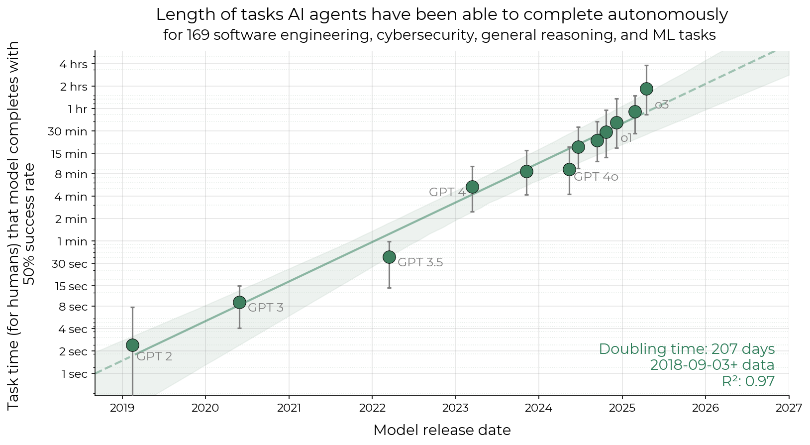
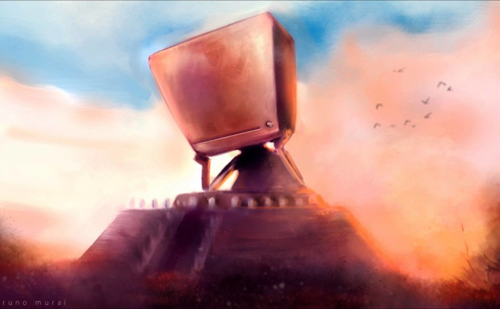

Séminaire LAPP : L'IA et l'Avenir de la Recherche\
• Durée : Présentation de 20–30 min + Discussion de 30 min (ou plus)

***

**IA et science : vers une automatisation de la recherche scientifique**1h 25m

Abstract:

L'IA agentique, ces systèmes capables de travailler de façon autonome en utilisant des outils et services informatiques (recherches web, génération et exécution de code, appels à des bases de données, etc.) et en prenant des décisions, est en train de révolutionner en profondeur l'ensemble des métiers et tâches intellectuels. La recherche ne fait pas exception, comme l'a démontré la mathapocalypse début octobre.

Dans ce séminaire-débat, je ferai un bilan des capacités actuelles de ces systèmes, des projections possibles, ainsi que des questions éthiques, environnementales, sociales et humaines que cela pose, en particulier pour le monde de la recherche et de la science dans un futur de plus en plus proche.

Ces changements s'accompagnent de leur lot d'émotions, tant ils touchent à notre identité et à nos valeurs. Ma courte présentation sera donc suivie d'un temps d'échange et de débat.

Ce séminaire s’adresse essentiellement aux chercheur-e-s qui sont les premiers concerné-e-s mais sera non technique et intéressant pour tout le monde

# 1. IA - kesako ?

- expliquer ce qu'est un modèle, un chatbot, un agent IA (explain tools), un harnais
- expliquer les niveaux d'autonomie: assistive (inline suggestions, completions...), conversational / chatbots, task agent (agent plans, edits, runs tests...), autonomous teammate (agent with backlog of tasks or a long-fetch objective. it's also proactive), teams of agents (very large parallelized problems that requires coordination among 100s of agents or more)

| Niveau               | Initiative               | Vérification              | Exemple en recherche               |
|----------------------|--------------------------|---------------------------|------------------------------------|
| 1. Assistant intégré | Humain, l'outil complète | Humain, en continu        | Autocomplétion de code             |
| 2. Chatbot           | Humain pose une question | Humain relit              | Reformuler, chercher une référence |
| 3. Agent             | Humain fixe un but       | Aux points de contrôle    | Schwartz, « Vibe physics »         |
| 4. Agent proactif    | L'agent déclenche        | Variable                  | **À remplir** (peu de littérature) |
| 5. Équipe d'agents   | Un orchestrateur         | Humains en bout de chaîne | Riemann, Fermat, Navier–Stokes     |

Message : on passe de « je fais » à « je dirige » puis « je juge ». **Plus on monte, plus la vérification est le facteur limitant.**

# 2. Questionnaire 

* Sondage interactif de l'auditoire (3 questions max) :
  1. Qui utilise déjà des assistants IA / LLM dans son travail au quotidien ?
  2. Pour quels types de tâches (codage, rédaction, bibliographie, brainstorming/réflexion) ?
  3. Quel est votre niveau de confort / d'appréhension face à leur intégration dans la recherche ?

* 

Fudan University, Shanghai Academy of AI for Science, & Springer Nature. AI for Science 2026. 2026. https://www.nature.com/immersive/partnercontent/fudan/aiforscience/ai-for-science-2026.pdf

* Positionnement personnel : Niveau 3 à 4, en gardant un oeil critique et une certaine dissonance cognitive sur certains aspects

## 3. Contexte & Taux de Progrès (Rate of Progress)

* Paysage actuel : Panorama des différents modèles (propriétaire vs open-source, taille) et de leurs capacités actuelles.

* Capacité des modèles frontières : 
  - Vidéo de Will Smith from 2023 to 2026: https://youtube.com/shorts/ygVLDfj2_F0?si=9KyE5fWOugUXwdCR
  - traduction de code entiers dans de nouveaux languages
Example: Bun : Zig → Rust (Jarred Sumner, 2026)
Environ 535 000 lignes de Zig, portées presque entièrement avec des agents Claude. Au 30 juillet, la version Rust expérimentale passait 99,8 % des tests de Bun sur Linux x64 glibc. Les versions stables sont encore livrées depuis la base Zig, donc le port n’est pas en production.
  - génération des software adobe / excel : ArtCraft est une suite de sept applications libres et gratuites, développées en Rust par Storyteller.ai, qui imitent Photoshop, Premiere, Lightroom, Illustrator et Acrobat, avec des outils d’IA intégrés pour la création d’images et de vidéos.  - https://raw.githubusercontent.com/storytold/gridcraft/main/docs/images/format-chart.png - https://raw.githubusercontent.com/storytold/photocraft/main/docs/images/photocraft-adjustments.jpg 
  - génération de jeux vidéos
  - blender and 3D models
 

* Rate of Progress : Présenter le diagramme length of tasks
https://metr.org/blog/2025-03-19-measuring-ai-ability-to-complete-long-tasks/

=> progrès exponentiel

Illustrations** (téléchargées, CC BY 4.0, attribution : Kwa, West et al., METR, arXiv 2503.14499)
- `public/illustrations/s2_metr_headline_log.png` : l'horizon de tâche en échelle log (slide 2.2).
  

mais mentionner les limites de cette mesure
- horizon à 80 % beaucoup plus court ; tâches logicielles vérifiables ; difficulté de tâche ≠ durée d'autonomie ; saturation des suites.
- croissance rapide et mesurable sur des tâches logicielles vérifiables, avec forte incertitude sur la généralisation
- ScanCode : Python → Rust, un contre-exemple instructif (AboutCode)
Un agent IA a porté une base Python mature en Rust. Le port publiait un benchmark annonçant des gains de 10× à 100×. Les mainteneurs ont montré que ScanCode, une fois optimisé de manière comparable, était aussi rapide ou plus rapide, et que le port couvrait moins de tests. Ils concluent que le port n’est pas conforme, et qu’il a sacrifié la correction des données pour paraître plus rapide. C’est le cas à méditer : une traduction « réussie » peut cacher des régressions silencieuses.
- fonctionnalité vs sécurité (souvent délaissée)

## 4. Automatisation et industrialisation des tâches intellectuels 

* le code en particulier: l'artisanat du développement est mort, nous passons à une ère d'industrialisation du logiciel -> Code Factories
* Démonstration de l'évolution des capacités de code des IAs (agentiques)
* Application de la partie code à la recherche permet déjà un niveau d'industrialisation de la recherche sans précédent

## 5. IA & Recherche Autonome (Derniers Résultats)

| Cas                      | Affirmé                                           | Vérifié / contesté                                                                                                 | Étiquette                       |
|--------------------------|---------------------------------------------------|--------------------------------------------------------------------------------------------------------------------|---------------------------------|
| ReplicationBench         | Répliquer des articles d'astro                    | 111 tâches / 20 articles ; < 20 % fin 2025                                                                         | PREPRINT                        |
| Vibe physics (mars 2026) | Article de QCD en 2 semaines, sous supervision    | Sur arXiv ; résultats ajustés par l'agent, documentés par l'auteur                                                 | ANNONCE INDUSTRIELLE + PREPRINT |
| Neuf boucles (sept.)     | Amplitude N=4 SYM à 9 boucles (record humain : 8) | Vérifiée par L. Dixon ; méthodes connues, plus de calcul ; une équipe humaine assistée d'IA avait déjà l'essentiel | ANNONCE (vérifiée en externe)   |
| Zéros de ζ (août)        | Fraction sur la droite critique 41,6 % → 67,2 %   | Relecture externe annoncée ; pas une avancée vers Riemann au sens fort                                             | ANNONCE INDUSTRIELLE            |
| Fermat (sept.)           | Formalisation Lean en 11 jours                    | Formalisation d'une preuve connue                                                                                  | ÉTABLI techniquement, mal titré |
| Navier–Stokes (8 sept.)  | Explosion en temps fini, **forçage lisse**        | Priorité et formulation contestées                                                                                 | CONTESTÉ                        |
| Mathapocalypse (6 oct.)  | 722 manuscrits / 372 problèmes                    | Non relus ; 3 retirés en 24 h, 14 révisés                                                                          | PREPRINT / CONTESTÉ             |

Instruction: créer une timeline visuelle (et si possible interactive) - voir aussi timeline.md

## 6. Pourquoi les maths d'abord 

- travail sans données (ou données peuvent être générées très facilement)
- preuves formalisables
- calculs fermés et vérifiables

L'IA est très bonne pour certains problèmes
- en particulier pour faire des liens à très longue distance, dans des domaines qui ne se parlent pas
- Elle peut également attaquer des problèmes sans nos apriori (plusieurs problèmes de maths résolus parce que la communauté maths pensaient que ce n'était pas la bonne voie - https://www.youtube.com/watch?v=dsBXYAwQieI)
- là où les données sont abondantes (« hill-climbing collectif »)
- https://www.anthropic.com/research/claude-shaped-science

## 7. Réaction de la communauté mathématiques

* réactions de la communauté mathématique : très différentes, d'horifiés à excités -> ajouter des citations
  - si vous déprimez, allez voir https://www.youtube.com/watch?v=LKrwhjOI8Nc

* vol de la recherche ?

* dump de papiers sans relecture, souvent très difficiles à lire, sans citation ni références aux travaux précédents -> c'est à la communauté maths de faire le travail de nettoyage, de digestion, de compréhension, de transmission

* "Les réflexions sur l'IA nous téléportent à un endroit de la réflexion, mais sans avoir fait le cheminement — et finalement, on rate beaucoup de choses."

https://www.lemonde.fr/idees/article/2026/09/11/la-mise-en-garde-de-25-medailles-fields-les-objectifs-des-entreprises-d-ia-et-ceux-de-la-communaute-mathematique-divergent-profondement_6770630_3232.html

* Declaration from Fields medals: https://mathandai.org/

* il n'y a plus rien à faire pour les mathématiciens ? => si, mais peut-être que l'exercice de démontrer un théorème n'est plus ce qu'il faut demander. Reste à comprendre, traduire en language humainement compréhensible, transmettre, enseigner...

* _What’s the Future for Pure Math Research in the Age of AI?_, S. Wolfram - https://writings.stephenwolfram.com/2026/09/whats-the-future-for-pure-math-research-in-the-age-of-ai/

## L'impact individuel

Win: Productivity, Quality of work (sometimes), Learning (AI teacher)
Loose: know-how, skills, mastery, understanding, joy, identity, craftmanship/job

## L'impact collectif et l'avenir du métier de chercheur

**5.1 Le paradoxe de Hao et al. (2 min)**
- 41,3 M d'articles, sciences naturelles. Avec l'IA : ~×3 en publications, ~×4,8 en citations, accès plus précoce au statut de responsable de projet. Mais **−4,63 % de sujets étudiés collectivement** et **−22 % d'engagement** entre chercheurs.

- est-ce qu'on saura poser les bonnes questions ?

  - `public/illustrations/s4_deep_thought.jpg` : visuel Deep Thought / 42 (copie du fichier de `public/`, AJOUTER CITATION AUTEUR 
    

- impact écologique

- impact éthique, le processus de recherche scientifique est en train d'être siphonné et accaparé par des entreprises privées

| hyopthèse                                                                               | oui                                                                                                                                                                               | mais                                                                                                                                                                                        |
|-----------------------------------------------------------------------------------------|-----------------------------------------------------------------------------------------------------------------------------------------------------------------------------------|---------------------------------------------------------------------------------------------------------------------------------------------------------------------------------------------|
| A. La production scientifique n'est plus la bonne métrique de promotion                 | Le coût marginal de produire un article baisse                                                                                                                                    | La métrique était déjà critiquée avant l'IA (DORA 2012, Leiden 2015)                                                                                                                        |
| B. Le recrutement et la formation des jeunes sont menacés                               | Si un travail de thèse peut être fait par une IA, est-ce qu'on prend encore un(e) étudiant(e) ? Si avec une ANR ou une ERC je paye une armée d'agents IA plutôt que de recruter ? | Shen & Tamkin ; « G2 forme les G3 »                                                                                                                                                         |
| Promotion : La production scientifique est-elle encore la bonne métrique de promotion ? | Différence d'accès aux outils / IAs                                                                                                                                               | Si au contraire je passe du temps à former de jeunes chercheurs, est-ce que c'est pris en compte ?                                                                                          |
| C. Les AAP n'ont plus de sens                                                           | Les AAPs sont écrites et relues par des IAs. La production scientifique directement proportionnelles au capital mis dans les IAs ?                                                | Les AAP ont des défauts connus depuis longtemps ; la physique des hautes énergies est déjà « proportionnelle aux capitaux » ; les coûts d'inférence baissent ; les modèles ouverts existent |
| D. Le choix des sujets est en jeu                                                       | Hao et al. : −4,63 % de sujets ; « sujets en forme de Claude »                                                                                                                    | Corrélationnel ; l'IA peut aussi abaisser le coût d'entrée sur des sujets de niche ; le goût humain est lui-même biaisé (effet mode)                                                        |

## 9. Questions Philosophiques & Avenir du Métier de Chercheur

• Impact sur la recherche :

• Que signifie "faire de la recherche" et "être chercheur" aujourd'hui ?

• Si l'IA atteint les capacités d'un stagiaire ou d'un doctorant : quel avenir pour les profils juniors ? Conséquences pour les seniors ?

• Raison d'être de la recherche :

• Fait-on de la recherche pour découvrir des choses, pour le développement technologique, ou pour soi-même (la compréhension) ?

• Compréhension humaine : L'IA ne comprendra jamais les choses à notre place.

• Citation / Réflexion sur la téléportation :

• "Les réflexions sur l'IA nous téléportent à un endroit de la réflexion, mais sans avoir fait le cheminement — et finalement, on rate beaucoup de choses."

https://www.lemonde.fr/idees/article/2026/09/11/la-mise-en-garde-de-25-medailles-fields-les-objectifs-des-entreprises-d-ia-et-ceux-de-la-communaute-mathematique-divergent-profondement_6770630_3232.html

Declaration from Fields medals: https://mathandai.org/

Finalement, est-ce que nous allons créer Deep Thoughts et la réponse sera 42 ?\
illustration : https://media.licdn.com/dms/image/v2/C5612AQHne3QPXT7ovw/article-cover_image-shrink_720_1280/article-cover_image-shrink_720_1280/0/1520180222176?e=1791417600&v=beta&t=VG0vxlQ5gnAA7OgjX5hJ8cdbZ5sv6WT6O5gh2HwPn4c

=> problème humain et institutionnel. Quelles motivations et quelles incitations donner aux jeunes chercheurs ?

Vincent Reverdy : Comment choisir un sujet de thèse pour un étudiant en prenant le risque qu'il sera résolu en 10 minutes par une IA avant la fin de sa thèse ?

## 6. Enjeux Économiques & Décisions Humaines :

• La science va-t-elle devenir dictée par les capitaux ? (Celui qui a le plus de capital possède plus de puissance de calcul et fait plus de recherche/science).

• Les capitaux n'étant jamais illimités, la question des choix reste centrale : la décision finale reviendra toujours aux humains pour définir les priorités ("sur quoi veut-on travailler ?", "qu'est-ce qui en vaut la peine ?").

## 7. Goût (Taste), Intuition & Rôle Essentiel du Chercheur :

• Lien avec la notion de "taste" (très présente en IA, développement logiciel et vibe coding) : ce qui reste le propre de l'humain face à la génération automatique.

• Le taste comme intuition scientifique : savoir détecter quelle direction vaut la peine d'être explorée sans avoir encore toutes les preuves.

• Réflexion (en lien avec Terence Tao) : l'IA peut exécuter ou déduire, mais c'est l'intuition humaine du chercheur qui donne l'orientation fondamentale et choisit les problèmes qui ont du sens ou simplement que nous trouvons important

* *We can see physics—or indeed natural science in general—as an effort to take the complexities of the natural world and find aspects that can be described by* *[narratives that fit in finite human minds](https://writings.stephenwolfram.com/2023/12/observer-theory/)**.* - [https://writings.stephenwolfram.com/2026/09/whats-the-future-for-pure-math-research-in-the-age-of-ai](https://writings.stephenwolfram.com/2026/09/whats-the-future-for-pure-math-research-in-the-age-of-ai/?via=dailydev).
  * *In other words, the problem of advancing pure mathematics is at some level not so much about pushing back some raw metamathematical frontier as about finding human ways to represent what’s there.* 

## 8. Questionnements Éthiques & Captation du Processus Scientifique :

• Écologie : Empreinte carbone, consommation d'énergie et ressources nécessaires au développement et à l'entraînement des IA.

• Captation des connaissances : Les IA ont aspiré le savoir accumulé à l'échelle de la planète.

• Aspiration du processus scientifique et de l'intuition :

• Les grandes entreprises continuent d'absorber non seulement les résultats publiés, mais aussi toutes nos directions de recherche, raisonnements et démarches en cours.

• Risque d'infusion dans les modèles propriétaires de tout le travail implicite (la part non écrite de la recherche, la méthode, la problématisation et l'intuition humaine) au profit d'acteurs privés.

## Ce que les humains apportent encore au processus de recherche :

* accountability
* long-term goals and choices
* relationship and trust
* ~~unwritten know-how~~ -> being captated as we speak

# ressources

https://www.youtube.com/watch?v=LKrwhjOI8Nc

https://www.anthropic.com/research/yes-claude-can-do-nine-loops#an-addendum-how-does-it-feel-to-be-scooped-by-a-machine

https://arxiv.org/abs/2510.24591

https://link.springer.com/article/10.1007/s00146-025-02190-4

https://situational-awareness.ai/from-agi-to-superintelligence/

https://www.youtube.com/watch?v=dsBXYAwQieI

https://www.youtube.com/watch?v=zONGVaONKe8

https://youtu.be/zONGVaONKe8?si=thM8UbF4Z22RMfIO&t=36 (end at 1:42)

For devs: https://www.youtube.com/watch?v=3TNpOD6bov8

***

https://gamma.app/docs/uo66zs0j0scpyfz?agent=2026-10-21T14-42-31-049Z_397a61e8-db46-4d31-8730-8cc0933c9fc9
